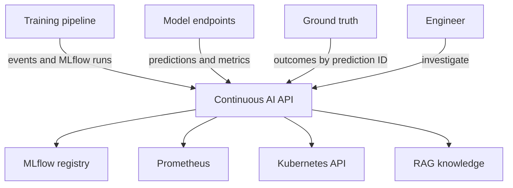

# Continuous AI MLOps Assistant

A Kubernetes-native, agentic RAG application that connects to both the **ML pipeline** and
**model-serving endpoints**. It correlates training metadata, MLflow registry state, predictions,
ground truth, Prometheus telemetry, Kubernetes health, model cards, policies, and runbooks.

The first release is deliberately read-mostly: it investigates, calculates quality, and recommends
experiments. Experiment jobs are behind an explicit feature flag and approval field. Production
promotion and traffic mutation are not implemented as free-form agent tools.

## Architecture



## What is included

- FastAPI service and OpenAI Responses API tool loop
- local RAG over Markdown policies and runbooks
- MLflow alias/run connector
- Prometheus query connector
- model endpoint health/predict connector
- Kubernetes read-only deployment/event connector
- prediction-to-ground-truth joining and classification/regression metrics
- pipeline, serving, and ground-truth integration examples
- Docker Compose for local use
- Helm chart with namespaced least-privilege RBAC
- Terraform-only deployment for an existing cluster, GKE, EKS, or AKS
- tests and GitHub Actions CI

## 1. Run locally

Requirements: Python 3.11+, Docker with Compose v2, and an OpenAI API key.

```bash
cp .env.example .env
# Edit .env and set OPENAI_API_KEY and a strong WEBHOOK_SECRET.
docker compose up --build -d
curl http://localhost:8080/health
```

Ask a question:

```bash
curl -X POST http://localhost:8080/v1/chat \
  -H 'Content-Type: application/json' \
  -d '{"message":"Inspect fraud-detector quality and explain what evidence is missing."}'
```

OpenAPI documentation is at `http://localhost:8080/docs`.

## 2. Build and push the image

Set your registry path once:

```bash
export IMAGE_REPOSITORY=ghcr.io/YOUR_ORG/continuous-ai-mlops
export IMAGE_TAG=0.1.0
docker build -t "$IMAGE_REPOSITORY:$IMAGE_TAG" .
docker push "$IMAGE_REPOSITORY:$IMAGE_TAG"
```

Use Artifact Registry, ECR, or ACR instead of GHCR when preferred. Authenticate to the selected
registry before pushing. Private registries also require an image-pull secret or workload identity.

## 3. Deploy with Terraform

Every deployment uses Terraform to install the same Helm release. Choose exactly one environment.
Keep Terraform state in a protected remote backend before team or production use.

Set secrets through environment variables so they do not enter `terraform.tfvars`:

```bash
export TF_VAR_openai_api_key='YOUR_API_KEY'
export TF_VAR_webhook_secret="$(openssl rand -hex 32)"
```

### Existing Kubernetes cluster

```bash
cd terraform/environments/existing-cluster
cp terraform.tfvars.example terraform.tfvars
# Edit image, MLflow, Prometheus, namespace, and endpoint values.
terraform init
terraform plan -out=tfplan
terraform apply tfplan
```

### GCP / GKE

Authenticate with Application Default Credentials and enable Compute and Kubernetes Engine APIs.

```bash
gcloud auth application-default login
cd terraform/environments/gcp
cp terraform.tfvars.example terraform.tfvars
terraform init
terraform plan -out=tfplan
terraform apply tfplan
```

### AWS / EKS

Configure AWS credentials using the normal AWS CLI credential chain.

```bash
aws sts get-caller-identity
cd terraform/environments/aws
cp terraform.tfvars.example terraform.tfvars
terraform init
terraform plan -out=tfplan
terraform apply tfplan
```

### Azure / AKS

```bash
az login
az account set --subscription YOUR_SUBSCRIPTION_ID
cd terraform/environments/azure
cp terraform.tfvars.example terraform.tfvars
terraform init
terraform plan -out=tfplan
terraform apply tfplan
```

Verify any deployment:

```bash
kubectl -n continuous-ai rollout status deployment/continuous-ai
kubectl -n continuous-ai port-forward service/continuous-ai 8080:8080
curl http://localhost:8080/health
```

Destroy the selected environment from the same directory:

```bash
terraform plan -destroy -out=destroy.tfplan
terraform apply destroy.tfplan
```

## 4. Connect the ML pipeline

Add a final pipeline component that runs after evaluation and registration. It should:

1. log parameters, metrics, artifacts, dataset version, and Git commit to MLflow;
2. register the candidate model and assign aliases according to your approval process;
3. POST a lifecycle event to `/v1/events/pipeline`;
4. retain the returned event ID in the pipeline logs.

Use [examples/pipeline_hook.py](examples/pipeline_hook.py) from Airflow, Kubeflow Pipelines, Argo
Workflows, Vertex AI Pipelines, SageMaker Pipelines, Azure ML, or a plain Python workflow.

Inside the cluster:

```bash
export CONTINUOUS_AI_URL=http://continuous-ai.continuous-ai.svc.cluster.local:8080
export CONTINUOUS_AI_WEBHOOK_SECRET='same-value-used-by-Terraform'
python examples/pipeline_hook.py
```

The event does not copy the model artifact. The assistant follows `run_id`, `model_name`, and
`model_version` to MLflow, leaving MLflow as the system of record.

## 5. Connect model-serving endpoints

Configure an endpoint map in the selected `terraform.tfvars`:

```hcl
model_endpoints = {
  fraud-detector   = "http://fraud-detector.models.svc.cluster.local:8080"
  demand-forecast  = "http://demand-forecast.models.svc.cluster.local:8080"
}
```

Each service should expose:

- `GET /health` returning model name, version, and readiness;
- `POST /predict` for controlled evaluation calls;
- `GET /metrics` in Prometheus format;
- a stable `prediction_id` in every prediction response.

Copy the patterns in [examples/model_server_instrumentation.py](examples/model_server_instrumentation.py).
For real traffic, publish prediction events asynchronously through Kafka, Pub/Sub, or Kinesis rather
than adding a synchronous dependency on the assistant.

## 6. Connect ground truth

Accuracy cannot be measured from predictions alone. Your outcome or labeling pipeline must send:

```json
{
  "prediction_id": "the-original-prediction-uuid",
  "actual": 1,
  "observed_at": "2026-08-25T15:00:00Z"
}
```

The `prediction_id` is the join key. Run [examples/send_ground_truth.py](examples/send_ground_truth.py)
from a scheduled warehouse job, labeling workflow, or outcome-processing pipeline.

## 7. Connect MLflow

Set `mlflow_tracking_uri` to a network-reachable MLflow Tracking Server. The assistant reads aliases
such as `champion` and `challenger`, their run IDs, metrics, parameters, tags, and artifact URIs.

Recommended model tags:

```text
dataset.version=transactions-2026-08-25
git.commit=4fd901a
task.type=classification
primary.metric=recall
owner=fraud-platform
```

Use a service identity or MLflow authentication proxy in production. Do not place MLflow passwords in
Helm values or Git.

## 8. Connect Prometheus

Set `prometheus_url` to the Prometheus HTTP endpoint. The connector queries:

- `model_requests_total{model_name,version,status}`
- `model_request_duration_seconds_bucket{model_name,version}`

The Helm chart can create a `ServiceMonitor` when the Prometheus Operator CRD exists:

```hcl
service_monitor_enabled = true
```

Prometheus access is HTTP network access; it does not require Kubernetes RBAC. If Prometheus enforces
authentication, place a small authenticated proxy in front of it or extend the connector to use your
cloud workload identity.

## 9. Permissions and safety

The Helm chart creates a dedicated service account. In the model namespace it can read pods, pod
logs, Services, Events, Deployments, and ReplicaSets. It cannot read Secrets, mutate Deployments,
change traffic, or promote an MLflow model.

Setting `allowExperimentJobs=true` adds namespaced Kubernetes Job permissions. Leave it false until
you implement signed, allow-listed experiment job templates. `ALLOW_PRODUCTION_WRITES` is reserved and
defaults to false; this repository intentionally has no unrestricted production mutation tool.

See [docs/security-and-permissions.md](docs/security-and-permissions.md) and
[docs/integration-contracts.md](docs/integration-contracts.md) for the complete contracts.

## 10. Production evolution

This MVP uses SQLite and therefore runs one application replica. Before horizontal scaling, replace
`EventStore` with PostgreSQL and store high-volume prediction events in Kafka/Pub/Sub/Kinesis plus a
warehouse or lakehouse. Keep online requests independent from assistant availability.

Suggested next components are a drift evaluator, an approved Kubernetes experiment runner,
champion/challenger comparison reports, and a GitOps pull-request action for canary changes.

## Test

```bash
python -m pip install -e '.[dev]'
ruff check src tests examples
pytest -q
terraform fmt -check -recursive terraform
helm lint helm/continuous-ai
```

## Publish as a Git repository

```bash
git init
git add .
git commit -m "Initial Continuous AI MLOps Assistant"
git branch -M main
git remote add origin git@github.com:YOUR_ORG/continuous-ai-mlops.git
git push -u origin main
```

Do not commit `.env`, `terraform.tfvars`, state files, API keys, webhook secrets, cloud credentials, or
kubeconfig files. Replace `your-org` image references before publishing. A short project description
for AIopsmlops.com is available in [docs/site-description.md](docs/site-description.md).

The OpenAI integration uses the Responses API function-calling loop; the local knowledge retriever is
replaceable with pgvector or another vector service without changing the agent-facing tool contract.


## Repository packaging note

The current default branch contains the packaged `continuous-ai-mlops.tar.gz` artifact rather than the expanded source tree. The feature list above describes the packaged application; this repository's CI verifies archive readability only and does not execute the application's tests. Inspect the archive contents and review its deployment permissions before use.

## Portfolio ownership

Continuous AI MLOps assistant prototype. Review the packaged source archive and its deployment permissions before treating it as executable or production-ready.

Account-wide ownership and cleanup decisions are maintained in the [WSP portfolio repository catalog](https://github.com/zeiglerit-aiml/WSP_Integrated_AI_SDLC_GVC_pl/blob/main/REPOSITORY_CATALOG.md).

## Portfolio boundary

This repository owns the **MLOps operations assistant** layer: MLflow run/registry context, serving endpoint health, prediction-to-ground-truth quality, Prometheus telemetry, Kubernetes read-only diagnostics, and controlled operator recommendations. Its knowledge base and tools are oriented to ML platform operations.

It is distinct from the proprietary Golden Container Batman & Robin concept, which owns a general task-scoped learning and execution lifecycle (task contract, task-specific knowledge, bounded planning/actions, and validated task learning). Golden Container may integrate selected MLOps capabilities from this repository through explicit, versioned adapters rather than duplicating platform connectors.

It is also distinct from WSP, which owns model artifact intelligence and assurance: architecture-aware weight-space inspection, behavioral/knowledge evaluation, model-change and unlearning evidence, and the canonical WSP workflow contract. This assistant may consume WSP evidence for operator workflows but does not replace WSP checks or GVC policy authority.
